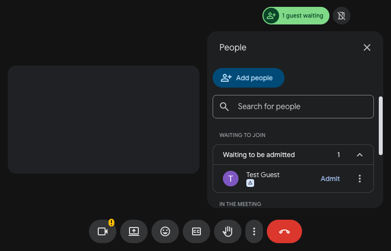

  

<h1 align="center">Auto Admit for Google Meet</h1>

  <b>Admit everyone who asks to join your Google Meet call.</b> 
  A small Chrome extension for hosts, with no settings, no server and no account.

  English · <a href="README.zh-TW.md">繁體中文</a>

  

---

## What it is

When you host a large call, join requests keep interrupting you. This extension presses the admit button for you on the Google Meet page, so people get in without waiting.

It admits everyone who asks. Turn it off for a call where you want to choose who joins.

## Features

- **Admits one person or many.** It opens the waiting list when it needs to, then admits a single person or several.
- **Opens Companion mode.** Click the icon on a call to open it in a new tab in Companion mode.
- **Runs only on Meet.** It works on `meet.google.com` and does nothing elsewhere.
- **Sends nothing anywhere.** It has no server and no analytics.

## Install

Install it from the [Chrome Web Store](https://chromewebstore.google.com/detail/glcbbkcdolbmdcojbfochcekjfnencfc).

To run it from the source instead:

1. Clone this repository.
2. Open `chrome://extensions` and turn on **Developer mode**.
3. Choose **Load unpacked** and select the `extension` folder.

## Use it

1. Install it. It's on from then on.
2. Open a Google Meet call as the host.
3. To stop admitting people, turn it off in `chrome://extensions`.

## Limits

- It works only while the Meet tab is open, and only for someone who is allowed to admit people.
- It reads the text of Meet's buttons, so a change to Meet can stop it working until the extension is updated.
- Admitting works on Meet pages in English, Traditional Chinese, Simplified Chinese and Japanese. Companion mode works in English, Traditional Chinese and Japanese.

## Privacy and permissions

Auto Admit for Google Meet has no server and no analytics, and it sends nothing to its authors. It stores nothing. On Meet it reads only the text of the page's buttons, to find the ones it presses. The full [privacy policy](PRIVACY.md) is in this repository and at https://v-ax.com/privacy/auto-admit-meet/. [SECURITY.md](SECURITY.md) explains each permission.

## Contributing

See [CONTRIBUTING.md](CONTRIBUTING.md). A new Meet language is usually a one-line change.

## License

The code is under the [MIT License](LICENSE). The icon isn't: see [BRAND.md](BRAND.md).

Auto Admit for Google Meet is an independent project. It is not made by, affiliated with or endorsed by Google. Google Meet and Chrome are trademarks of Google LLC.

Made by [V-AX](https://v-ax.com).
