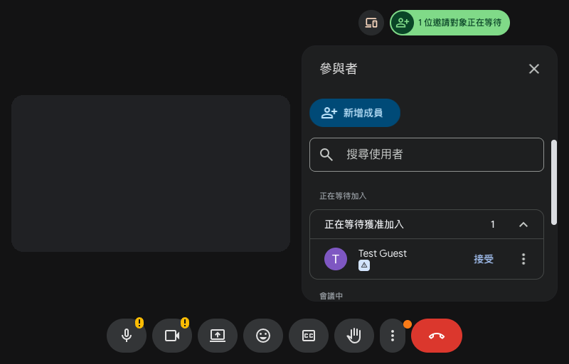

  

<h1 align="center">線上會議自動接受工具</h1>

  <b>自動接受 Google Meet 通話的所有加入要求。</b> 
  給主辦人用的小型 Chrome 擴充功能，不用設定、沒有伺服器，也不用帳號。

  <a href="README.md">English</a> · 繁體中文

  

---

## 這是什麼

主持大型通話時，加入要求會一直打斷你。這個擴充功能會在 Google Meet 頁面上替你按下接受，大家不用等就能進來。

它會接受每一個提出要求的人。需要自己挑選加入者的通話，請先把它關閉。

## 功能

- **一位或多位都能接受。** 需要時會自己打開等待名單，接受一位或多位後再把名單關回去；你自己打開的名單不會被關掉。
- **開啟夥伴模式。** 在通話中點圖示，會開新分頁並以夥伴模式加入。
- **只在 Meet 執行。** 只在 `meet.google.com` 運作，其他網站不做任何事。
- **不傳任何資料。** 沒有伺服器，也沒有使用分析。

## 安裝

從 [Chrome 線上應用程式商店](https://chromewebstore.google.com/detail/glcbbkcdolbmdcojbfochcekjfnencfc)安裝。

也可以直接從原始碼執行：

1. 複製這個 repository。
2. 打開 `chrome://extensions`，開啟**開發人員模式**。
3. 選擇**載入未封裝項目**，再選 `extension` 資料夾。

## 使用方式

1. 安裝後就會開始運作。
2. 以主辦人身分開啟 Google Meet 通話。
3. 不想自動接受時，到 `chrome://extensions` 把它關閉。

## 限制

- 只有 Meet 分頁開著、而且你有權限接受加入者時才有作用。
- 它靠 Meet 按鈕上的文字辨識，Meet 改版可能讓它失效，要等擴充功能更新。
- 自動接受支援英文、繁體中文、簡體中文和日文的 Meet 頁面。夥伴模式支援英文、繁體中文和日文。

## 隱私與權限

線上會議自動接受工具沒有伺服器，也沒有使用分析，不會傳任何資料給作者，也不儲存任何資料。在 Meet 上只讀取網頁按鈕的文字，用來找到要按的按鈕。完整內容請看[隱私權政策](PRIVACY.md#繁體中文)，也公布在 https://v-ax.com/privacy/auto-admit-meet/。每項權限的用途請看 [SECURITY.md](SECURITY.md)。

## 參與貢獻

請見 [CONTRIBUTING.md](CONTRIBUTING.md)。支援新的 Meet 語言通常只要改一行。

## 授權

程式碼以 [MIT License](LICENSE) 釋出。圖示不在此授權內，見 [BRAND.md](BRAND.md)。

線上會議自動接受工具是獨立專案，並非由 Google 製作，也與其沒有關係或背書。Google Meet 和 Chrome 是 Google LLC 的商標。

由 [V-AX](https://v-ax.com) 製作。
